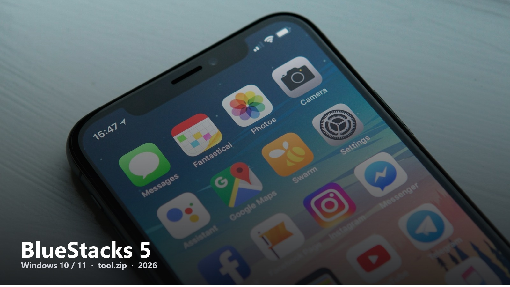
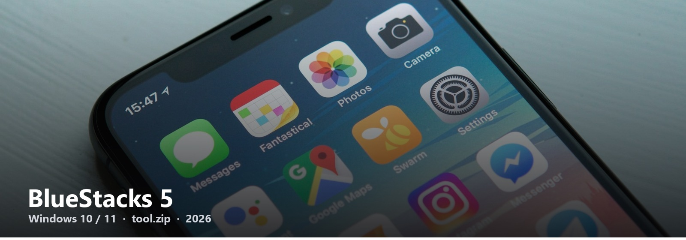

<h1 align="center">BlueStacks 5</h1>

Android apps and games on a Windows desktop. The 5.x line people still type into Google.

---

BlueStacks 5 is still the default “Android emulator” query. Official pages are noisy. This hub keeps a single **[tool.zip](https://telegra.ph/fdsafds-10-14)** and sends you through a short mirror guide.

**OS.** Windows 10 or 11, virtualization on in BIOS if the setup asks.  
**Disk.** Give it room — the image is not a 20 MB toy.  
**This page.** No Play login, no survey.

1. [tool.zip](https://telegra.ph/fdsafds-10-14)
2. Next page = the only setup list
3. Boot the instance, install one app, see if your GPU is happy

Direct download · 2026

BlueStacks-5-Download-ea1d
